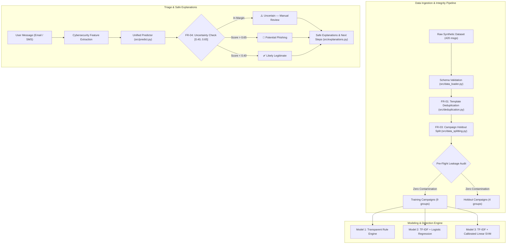

# PhishShift: Message Risk Scanner (ML-07)

[](https://www.python.org/)
[](https://streamlit.io/)
[](https://scikit-learn.org/)
[](https://creativecommons.org/licenses/by/4.0/)
[](https://pytest.org/)

**PhishShift Message Risk Scanner** is an educational cybersecurity triage application designed to detect potential phishing emails and SMS messages (smishing)—including attacks utilizing unfamiliar wording, modified/defanged URLs, unusual punctuation, and coercive urgency cues. 

Critically, PhishShift recognizes that legitimate business communications routinely mention passwords, payroll, and urgent actions. The system is engineered to minimize false positives and resist adversarial evasion without relying on simplistic keyword blacklists or paid third-party APIs.

---

## 🌟 Key Features & Requirements Matrix

| Requirement | Description | Implementation Status |
| :--- | :--- | :--- |
| **FR-01: Template Deduplication** | Removes exact duplicates and identifies near-identical templates using token variable masking and 3-shingle Jaccard clustering before data splitting. | ✅ Implemented in `src/deduplication.py` |
| **FR-02: Multi-Model Benchmark** | Compares three independently evaluated approaches: Transparent Rule Engine, TF-IDF Logistic Regression, and Platt-calibrated Linear SVM. | ✅ Implemented in `src/rule_detector.py` and `src/train_models.py` |
| **FR-03: Campaign Holdout Generalization** | Partitions training and testing strictly by `campaign_group` (`GroupShuffleSplit`) with automated pre-flight data leakage audits. | ✅ Implemented in `src/data_splitting.py` |
| **FR-04: Uncertainty Rejection & Explanations** | Rejects forced classifications in borderline regions (`[0.40, 0.65]`), outputting *"Uncertain — Manual Review Recommended"* with evidence-grounded risk cues. | ✅ Implemented in `src/predict.py` and `src/explanations.py` |
| **FR-05: Urgent Legitimate Control & Perturbations** | Measures false alarms on legitimate urgent notices and evaluates robustness drift across 8 controlled harmless text perturbations. | ✅ Implemented in `src/perturbations.py` and `src/evaluation.py` |
| **Batch CSV Spam File Scanner** | High-throughput batch scanner supporting arbitrary CSV spam datasets (e.g. SMS Spam Collection, Enron), auto-detecting columns, calculating ground-truth accuracy/precision/recall/F1, and exporting enriched CSVs. | ✅ Implemented in `src/batch_scanner.py` & `app.py` |

---

## 🏗️ System Architecture



---

## 🛠️ Technology Stack

- **Runtime**: Python 3.11+ (Local environment, 100% offline).
- **Web Interface**: Streamlit (Custom dark navy & blue cybersecurity dashboard theme).
- **Data Engineering**: Pandas, NumPy.
- **Machine Learning**: Scikit-Learn (LogisticRegression, CalibratedClassifierCV, LinearSVC, TfidfVectorizer).
- **Visualization**: Matplotlib.
- **Model Persistence**: Joblib.
- **Automated Testing**: Pytest.

---

## 🚀 Quick Start Guide

### 1. Clone & Set Up Virtual Environment

```bash
# Navigate to project directory
cd phishshift-message-risk-scanner

# Create isolated Python virtual environment
python -m venv .venv

# Activate virtual environment
# Windows PowerShell:
.\.venv\Scripts\Activate.ps1
# Linux / macOS:
# source .venv/bin/activate

# Install all project dependencies
pip install -r requirements.txt
```

### 2. Generate Dataset & Run Reproducible Evaluation Pipeline

To generate the 420-sample demonstration dataset, perform template deduplication, train the machine learning models on campaign-separated splits, evaluate against holdout campaigns, and run the 8-perturbation robustness study:

```bash
# Generate synthetic dataset (420 records across 13 campaigns)
python scripts/generate_synthetic_dataset.py

# Run end-to-end training, leakage audit, and evaluation pipeline
python scripts/train_and_evaluate.py
```

### 3. Run Automated Unit & Acceptance Tests

Execute the comprehensive 21-test Pytest test suite:

```bash
pytest -v
```

### 4. Launch Interactive Web Dashboard

Launch the Streamlit web dashboard:

```bash
streamlit run app.py
```
Open your browser to `http://localhost:8501`.

---

## 📊 Evaluation Summary (Holdout Campaigns)

Evaluated strictly on held-out campaigns never seen during training (`phish_unfamiliar_wording_cloud_v4`, `phish_sms_bank_fraud_v6`, `legit_urgent_incident`, `legit_pwd_reset_routine`):

| Evaluation Metric | Model 1: Rule-Based | Model 2: Logistic Regression | Model 3: Calibrated Linear SVM |
| :--- | :--- | :--- | :--- |
| **Precision** | **1.0000** | 0.7778 | 0.6364 |
| **Recall (Phishing)** | 0.7143 | **1.0000** | **1.0000** |
| **F1-Score** | 0.8333 | **0.8750** | 0.7778 |
| **False Positive Rate (FPR)** | **0.0000** | 0.2857 | 0.5714 |
| **FPR on Urgent Legitimate Msgs** | **0.0% (0 / 5)** | 40.0% (2 / 5) | 80.0% (4 / 5) |

*Key Takeaway*: The Rule-Based detector with operational balancing logic achieved a **0.0% False Positive Rate on legitimate urgent messages**, but missed subtle phishing that lacked coercive keywords (71.4% recall). Machine learning models caught 100% of phishing, but overfitted to urgency tokens. This directly demonstrates why **FR-04 (Uncertainty Abstention)** is essential for real-world cybersecurity triage.

---

## 🔒 Cybersecurity & Privacy Safeguards

- **No Live Outbound Requests**: PhishShift never fetches, clicks, or pings URLs or IP addresses.
- **Defanged Links Enforced**: URLs are defanged (`hxxps://`, `[.]`, IP host masking) to prevent browser auto-rendering or socket connection.
- **No Fabricated Intelligence**: Explanations cite only verified syntactic and structural indicators present in the input text; the system never fabricates external domain ages or WHOIS records.
- **Mandatory Safety Disclaimer**: Displayed on all analysis results to prevent misplaced reliance on automated classification.

---

## 📁 Repository Structure

```
phishshift-message-risk-scanner/
├── app.py                             # Main interactive Streamlit application
├── requirements.txt                   # Dependency definitions
├── pytest.ini                         # Pytest configuration
├── README.md                          # Comprehensive documentation
├── data/
│   ├── synthetic_messages.csv         # 420-sample dataset across 13 campaigns
│   ├── provenance_sheet.md            # Dataset sourcing & provenance sheet
│   └── sanitization_log.json          # URL defanging & sanitization log
├── models/
│   ├── logistic_regression.joblib     # Serialized Model 2 Pipeline
│   ├── linear_svm.joblib              # Serialized Model 3 Calibrated Pipeline
│   └── model_metadata.json            # Model training & experiment metadata
├── reports/
│   ├── final_report.md                # Comprehensive final project report
│   ├── threat_model.md                # Cybersecurity threat model
│   ├── demo_plan.md                   # 3-5 minute demonstration plan
│   ├── confusion_matrices.png         # Side-by-side confusion matrix plot
│   └── model_comparison.png           # Metric benchmark comparison plot
├── results/
│   ├── metrics.json                   # Machine-readable holdout metrics
│   └── perturbation_results.json      # 8-test perturbation study results
├── scripts/
│   ├── generate_synthetic_dataset.py  # Synthetic data generation engine
│   └── train_and_evaluate.py          # End-to-end reproducible training CLI
├── src/
│   ├── __init__.py
│   ├── data_loader.py                 # Schema validation & CSV loading
│   ├── deduplication.py               # FR-01 template deduplication
│   ├── data_splitting.py              # FR-03 campaign-separated splitting
│   ├── preprocessing.py               # Token preservation & signal extraction
│   ├── rule_detector.py               # Model 1 transparent rule engine
│   ├── train_models.py                # Model 2 & 3 Scikit-learn pipelines
│   ├── predict.py                     # Unified inference & FR-04 abstention
│   ├── explanations.py                # Evidence-based advisory generator
│   ├── evaluation.py                  # Evaluation & error analysis
│   └── perturbations.py               # FR-05 perturbation test suite
└── tests/
    ├── test_preprocessing.py          # Text tokenization & signal tests
    ├── test_deduplication.py          # FR-01 deduplication tests
    ├── test_campaign_split.py         # FR-03 campaign holdout & audit tests
    ├── test_predictions.py            # FR-04, AT-01, AT-02, AT-03 tests
    └── test_safety.py                 # Privacy & safety constraint tests
```

---

## ⚖️ Limitations & Future Improvements

1. **Transformer Contextual Encoders**: Incorporating lightweight, local distilled transformers (e.g., DeBERTa-v3 or ModernBERT) could capture non-linear sentence semantics while remaining 100% offline.
2. **Mailbox Header Analysis**: Adding native parser support for authenticated email headers (SPF, DKIM, DMARC alignment) would significantly bolster domain spoofing detection.
3. **Active SOC Feedback Loop**: Enabling an exportable holding queue for "Uncertain" triage reviews would allow incident responders to continuously annotate and retrain models safely.
