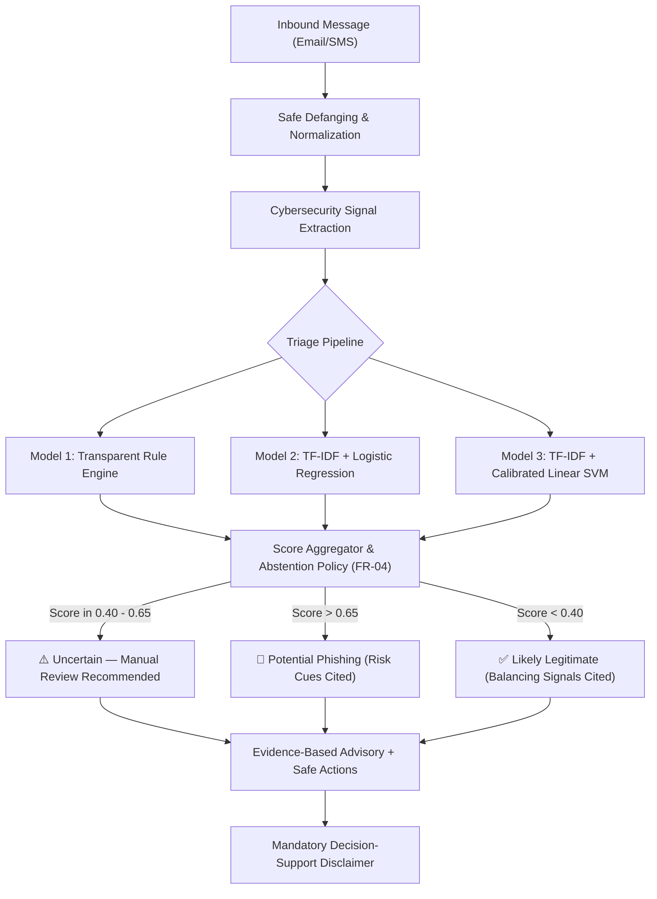

# Threat Model: PhishShift Message Risk Scanner (ML-07)

## 1. System Overview and Asset Classification

The **PhishShift Message Risk Scanner** is an educational triage decision-support platform designed to inspect inbound communications (Email and SMS) for social engineering, coercive urgency, credential theft, and smishing cues.

### Protected Assets
1. **User Safety & Credentials**: Preventing users from falling victim to credential harvesting, unauthorized funds transfers, or malicious software.
2. **Operational Continuity**: Minimizing false positives so legitimate urgent business alerts (P1 outages, scheduled maintenance, routine payroll) are not blocked or ignored.
3. **Model Integrity**: Preventing training data contamination and template memorization.
4. **Data Privacy**: Guaranteeing zero exfiltration of user communications to external cloud services or third-party APIs.

---

## 2. Threat Actors & Adversarial Profiles

| Threat Actor | Motivation | Capabilities | Target Vectors |
| :--- | :--- | :--- | :--- |
| **Mass Phishers** | Opportunistic credential & monetary theft | Automated template dispatch, URL shorteners | Generic suspension threats, fake invoice alerts |
| **Smishers (SMS)** | Quick-response mobile fraud | Telecom shortcode spoofing, defanged shortlinks | Package delivery alerts, fake bank transaction fraud |
| **Spear Phishers / BEC** | Targeted enterprise infiltration | Tailored executive tone, subtle unfamiliar wording | Collaborative cloud asset access, vendor milestone review |
| **Adversarial Evaders** | Bypassing ML/NLP message filters | Character spacing ("P A S S"), synonym substitution | Deliberate syntax and punctuation perturbations |

---

## 3. Threat Vectors & Attack Scenarios

### Vector 1: Coercive Urgency & False Authority
- **Mechanism**: Attackers impose severe, time-bounded penalties ("account will be suspended within 24 hours", "immediate termination").
- **Vulnerability**: Simple keyword matching flags words like "urgent" or "immediate", creating severe false alarms when legitimate IT/SRE teams announce production incidents.
- **Countermeasure (FR-05)**: PhishShift implements countervailing operational markers (e.g. absence of credential prompts, presence of internal ticket IDs, clear "if you did not request, ignore" phrasing) to suppress false positives on benign urgent messages.

### Vector 2: Unfamiliar Phrasing & Vocabulary Drift
- **Mechanism**: Attackers avoid obvious keywords like "password" or "bank", instead using formal collaborative phrasing ("organizational asset synchronization clearance", "contract ledger verification").
- **Vulnerability**: Bag-of-words and keyword filters miss novel lures that lack overt threat terms.
- **Countermeasure (FR-03 & FR-04)**: PhishShift evaluates generalization on held-out campaigns never seen during training. When scores fall in the uncertainty margin ([0.40, 0.65]), the system abstains from forcing a false classification and routes to manual human review.

### Vector 3: URL Obfuscation & Shortener Cloaking
- **Mechanism**: Attackers utilize URL shorteners (`bit[.]ly`, `tinyurl[.]com`) or direct IP address hosts (`hxxp://198[.]51[.]100[.]42`) to obscure fraudulent destinations.
- **Vulnerability**: Direct HTTP inspection could trigger malware or confirm user activity to attackers.
- **Countermeasure (Safety Constraint)**: PhishShift operates completely offline with zero active link fetching. URLs are defanged (`hxxp`, `[.]`), and structural indicators are sanitized into discrete categorical features.

### Vector 4: Data Contamination & Evaluation Leakage
- **Mechanism**: In naive ML splits, near-identical phishing templates appear in both training and test sets.
- **Vulnerability**: Models memorize template tokens (e.g. specific greeting formats or placeholder IDs) and score artificially high in testing while failing completely against new real-world campaigns.
- **Countermeasure (FR-01 & FR-03)**: Dynamic variable abstraction masks names, dates, amounts, and IDs. 3-shingle Jaccard clustering removes template clones. Holdout splits are strictly separated by `campaign_group`, verified via automated pre-flight leakage audits.

---

## 4. Defense-in-Depth Architecture

---

## 5. Security & Privacy Assurance Matrix

| Security Requirement | Status | Verification Evidence |
| :--- | :--- | :--- |
| **No Live Network Calls** | Enforced | Verified in `test_safety.py` (zero external sockets) |
| **Defanged Link Handling** | Enforced | All URLs sanitized (`hxxp://`, `[.]`, IP masking) |
| **No Fabricated Intelligence** | Enforced | Explanations cite only extracted syntactic/heuristic evidence |
| **PII & Credential Protection** | Enforced | 100% synthetic dataset; no real user credentials collected |
| **Mandatory Safety Disclaimers** | Enforced | Displayed prominently across scanner UI and advisories |
